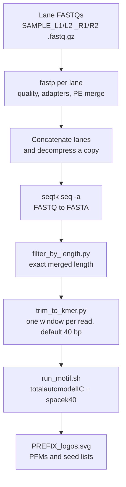

# SELEXpipe

SELEXpipe is a SELEX sequencing analysis pipeline by Tushar Warrier. It turns
paired-end HT-SELEX reads into fixed-width sequence libraries and runs motif
discovery on those libraries.

Two stages are implemented:

1. **Preprocessing** — adapter-aware paired-end merge, exact-length filtering, and one k-mer per molecule (default 40 bp). Short reads are dropped. Random bases are written only if you pass `--allow-pad` and `--seed`.
2. **Motif discovery** — `totalautomodelIC` (v0.22) with the external `spacek40` binary. The driver refuses a SEQ file that is empty or whose lines are not all the expected width.

Enrichment filtering beyond length, library reformatting, motif-position matching, and mutual-information analysis are described as later stages. They have no scripts in this repository.

## Pipeline



`scripts/01_preprocess/run_preprocess.sh` runs everything from `fastp` through the k-mer extract. `scripts/02_motif/run_motif.sh` runs motif discovery. Background and signal SEQ files are produced by running preprocessing on each library, then passed in as `--background` and `--signal`.

## Directory layout

```text
SELEXpipe/
├── README.md
├── config/
│   └── ligands.tsv                 # reference table; scripts do not load it
├── data/
│   └── examples/
│       ├── README.md
│       └── lig147_synthetic.fa     # synthetic 3-read FASTA, not a real run
├── docs/
│   ├── preprocessing.md            # flags, fastp defaults, file names
│   └── motif.md                    # totalautomodelIC arguments
├── envs/
│   ├── environment.yml             # conda: python, biopython, fastp, seqtk, bc
│   └── requirements.txt            # pip: biopython
├── scripts/
│   ├── 01_preprocess/
│   │   ├── run_preprocess.sh       # driver
│   │   ├── filter_by_length.py     # step inside the driver
│   │   └── trim_to_kmer.py         # step inside the driver
│   └── 02_motif/
│       ├── run_motif.sh            # driver; checks SEQ line width
│       └── totalautomodelIC        # upstream recipe, unmodified
└── tests/
    └── test_safe_extract.py        # exact-length, drop-short, no-pad, width guard
```

## Requirements

| Tool | Used by | How to install |
|------|---------|----------------|
| Python ≥ 3.9 | length filter, k-mer extract, SEQ width check | conda or system |
| Biopython ≥ 1.81 | `filter_by_length.py` | `envs/requirements.txt` or conda |
| fastp | lane merge | bioconda (`envs/environment.yml`) |
| seqtk | FASTQ → FASTA | bioconda |
| bash, gzip, cat | preprocessing driver | system |
| bc, awk, sed, grep | `totalautomodelIC` | system (`bc` is also in the conda env) |
| spacek40 | motif discovery | not shipped; no download URL is recorded here |

`fastp` and `seqtk` versions were not pinned in the original scripts, so `environment.yml` does not pin them either.

### Installation

Conda (preprocessing and motif shell tools, except `spacek40`):

```bash
conda env create -f envs/environment.yml
conda activate selexpipe
```

Python only (enough for the length filter, the k-mer extract, and the tests):

```bash
python3 -m pip install -r envs/requirements.txt
```

Place the `spacek40` binary in `scripts/02_motif/` or pass `--bin-dir`. The motif driver symlinks it into the working directory because `totalautomodelIC` calls `./spacek40`.

## Ligand lengths

These are merged construct lengths. ligN40 and ligN70 use different constant flanks, so the gap is 60 bp. The same table is hard-coded in `filter_by_length.py` and `run_preprocess.sh`. `config/ligands.tsv` repeats it for reference and is not read by the scripts.

| Ligand design | Expected merged length |
|---------------|------------------------|
| lig147        | 101 bp                 |
| lig200        | 154 bp                 |
| ligN40        | 187 bp                 |
| ligN70        | 247 bp                 |

Pass exactly one of `--ligand` or `--target-length`. There is no numeric default.

## Usage

### 1. Preprocessing

Inputs under `--input-dir` (four files per sample):

| File | Role |
|------|------|
| `{SAMPLE}_L1_R1.fastq.gz` | lane 1, read 1 |
| `{SAMPLE}_L1_R2.fastq.gz` | lane 1, read 2 |
| `{SAMPLE}_L2_R1.fastq.gz` | lane 2, read 1 |
| `{SAMPLE}_L2_R2.fastq.gz` | lane 2, read 2 |

The adapter FASTA is a separate argument (for example `Adapters_TruSeq3PE.fa`). This repository does not include one.

```bash
scripts/01_preprocess/run_preprocess.sh \
  --sample SAMPLE \
  --adapter-fasta ./Adapters_TruSeq3PE.fa \
  --ligand lig147 \
  --input-dir ./raw \
  --output-dir ./processed
```

Outputs under `processed/SAMPLE/`:

| File | Step |
|------|------|
| `SAMPLE_L1.fq.gz`, `SAMPLE_L1.json`, `SAMPLE_L1.html` | fastp, lane 1 |
| `SAMPLE_L2.fq.gz`, `SAMPLE_L2.json`, `SAMPLE_L2.html` | fastp, lane 2 |
| `SAMPLE.fq.gz`, `SAMPLE.fq` | concatenated lanes; gzipped file is kept |
| `SAMPLE.fa` | seqtk FASTA |
| `SAMPLE_101.fa` | reads kept at the ligand length (101 for lig147) |
| `SAMPLE_101.seq` | one 40 bp line per kept read |

`--skip-fastp` resumes from the lane-merged gzip files. `--kmer-start` or `--center-kmer` moves the extracted window. `--allow-pad --seed N` is the only way to add random ATCG. Details and the fastp flag table are in [`docs/preprocessing.md`](docs/preprocessing.md).

```bash
scripts/01_preprocess/run_preprocess.sh --help
```

### 1b. Length filter and k-mer extract on the synthetic example

These two commands do not need `fastp`, `seqtk`, or real FASTQs. From the repository root:

```bash
python3 scripts/01_preprocess/filter_by_length.py \
  data/examples/lig147_synthetic.fa \
  /tmp/SAMPLE_101.fa \
  --ligand lig147

python3 scripts/01_preprocess/trim_to_kmer.py \
  /tmp/SAMPLE_101.fa \
  /tmp/SAMPLE_101.seq \
  --kmer-size 40
```

The filter keeps the single 101 bp record. The SEQ file is one line of 40 `A`s. The 8 bp and 105 bp records are dropped.

### 2. Motif discovery

Run preprocessing separately on a background library and on an enriched (signal) library. SEQ lines must all have length `--seq-length` (default 40).

```bash
scripts/02_motif/run_motif.sh \
  --background ./processed/BACKGROUND/BACKGROUND_101.seq \
  --signal ./processed/SIGNAL_r4/SIGNAL_r4_101.seq \
  --output-prefix SIGNAL_r4v1 \
  --work-dir ./motif_out/SIGNAL_r4
```

| Input | Meaning |
|-------|---------|
| `--background` | SEQ from the naïve or input library |
| `--signal` | SEQ from an enriched round |
| `spacek40` in `--bin-dir` | external binary (default directory: `scripts/02_motif/`) |

| Output (in `--work-dir`) | Meaning |
|--------------------------|---------|
| `{prefix}_logos.svg` | accepted, unrefined, and rejected models |
| `{prefix}_refined_seeds.tmp.txt` | refined seeds |
| `{prefix}_refined_model*.tmp.pfm` and matching `.svg` | per-model artefacts from `totalautomodelIC` |

Argument defaults (multinomial `1`, seed length `6`, length cutoff `0.25`, IUPAC cutoff `-`, local-max cutoff `20`, logo number `50`, similarity `0.1`) match the recipe documented in [`docs/motif.md`](docs/motif.md). `totalautomodelIC` itself was not edited.

```bash
scripts/02_motif/run_motif.sh --help
```

## Tests

```bash
python3 -m pip install -r envs/requirements.txt
python3 -m unittest discover -s tests -v
```

The tests check that an exact-length read yields one window of the requested width, that a short read is dropped, that the default path writes no random bases, and that the motif driver rejects a SEQ line of the wrong width before it looks for `spacek40`.

## License

This repository has no license file. One was not added here. Until the maintainer chooses a license, reuse terms are unset.

## Citation

No publication is recorded in this repository. If you use the pipeline, cite the code:

https://github.com/double2strand/SELEXpipe

## Contact

Tushar Warrier. No other contact address is recorded in the repository. The initial commit is authored by that name on GitHub as `tw599`.
