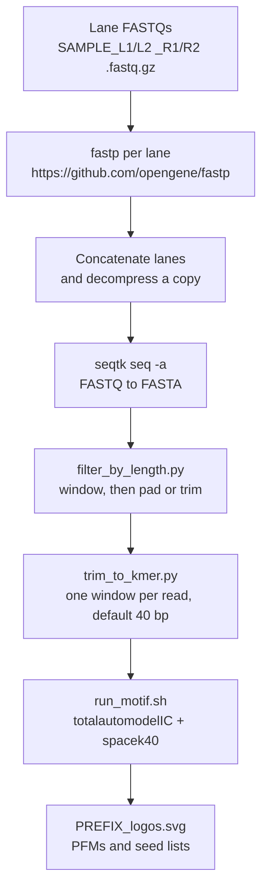

# SELEXpipe

SELEXpipe is a SELEX sequencing analysis pipeline by Tushar Warrier. It turns
paired-end HT-SELEX reads into fixed-width sequence libraries and runs motif
discovery on those libraries.

Two stages are implemented:

1. **Preprocessing** — adapter-aware paired-end merge with [fastp](https://github.com/opengene/fastp), a length-window filter that pads or trims reads to a target length, and one k-mer per molecule (default 40 bp). The k-mer step drops a short window unless you pass `--allow-pad` and `--seed`.
2. **Motif discovery** — `totalautomodelIC` (v0.22) with `scripts/02_motif/spacek40`. The driver refuses a SEQ file that is empty or whose lines are not all the expected width.

Enrichment filtering beyond length, library reformatting, motif-position matching, and mutual-information analysis are described as later stages. They have no scripts in this repository.

## Pipeline



`scripts/01_preprocess/run_preprocess.sh` runs everything from [fastp](https://github.com/opengene/fastp) through the k-mer extract. `scripts/02_motif/run_motif.sh` runs motif discovery. Background and signal SEQ files are produced by running preprocessing on each library, then passed in as `--background` and `--signal`.

## Directory layout

```text
SELEXpipe/
├── README.md
├── config/
│   ├── adapters.fa                 # example fastp adapters
│   └── ligands.tsv                 # reference table; scripts do not load it
├── data/
│   └── examples/
│       ├── README.md
│       └── lig147_synthetic.fa     # synthetic 3-read FASTA, not a real run
├── docs/
│   ├── preprocessing.md            # flags, fastp defaults, file names
│   └── motif.md                    # totalautomodelIC arguments
├── envs/
│   ├── environment.yml             # conda: python, biopython, fastp, seqtk, bc
│   └── requirements.txt            # pip: biopython
├── scripts/
│   ├── 01_preprocess/
│   │   ├── run_preprocess.sh       # driver
│   │   ├── filter_by_length.py     # step inside the driver
│   │   └── trim_to_kmer.py         # step inside the driver
│   └── 02_motif/
│       ├── run_motif.sh            # driver; checks SEQ line width
│       ├── spacek40                 # binary used by totalautomodelIC
│       └── totalautomodelIC        # upstream recipe, unmodified
└── tests/
    └── test_safe_extract.py        # k-mer extract, length window, motif width guard
```

## Requirements

| Tool | Used by | How to install |
|------|---------|----------------|
| Python ≥ 3.9 | length filter, k-mer extract, SEQ width check | conda or system |
| Biopython ≥ 1.81 | `filter_by_length.py` | `envs/requirements.txt` or conda |
| [fastp](https://github.com/opengene/fastp) | lane merge | [install from the fastp repo](https://github.com/opengene/fastp), or bioconda (`envs/environment.yml`) |
| seqtk | FASTQ → FASTA | bioconda |
| bash, gzip, cat | preprocessing driver | system |
| bc, awk, sed, grep | `totalautomodelIC` | system (`bc` is also in the conda env) |
| spacek40 | motif discovery | shipped at `scripts/02_motif/spacek40` |

[fastp](https://github.com/opengene/fastp) and `seqtk` versions were not pinned in the original scripts, so `environment.yml` does not pin them either.

### Installation

[fastp](https://github.com/opengene/fastp) is the paired-end merge and adapter trimmer. Install it from that repository, or let conda install the bioconda package when you create the environment below.

Conda (preprocessing tools; `spacek40` is already in the repository):

```bash
conda env create -f envs/environment.yml
conda activate selexpipe
```

Python only (enough for the length filter, the k-mer extract, and the tests):

```bash
python3 -m pip install -r envs/requirements.txt
```

`scripts/02_motif/spacek40` is the binary `totalautomodelIC` calls. `run_motif.sh` defaults `--bin-dir` to that directory and symlinks `spacek40` into the working directory, because `totalautomodelIC` runs `./spacek40`.

## Ligand lengths

These are merged construct lengths. ligN40 and ligN70 use different constant flanks, so the gap is 60 bp. The lengths are hard-coded in `run_preprocess.sh` (`ligand_length`). `filter_by_length.py` does not know ligand names. `config/ligands.tsv` repeats the table for reference and is not read by the scripts.

| Ligand design | Expected merged length | Driver window if you omit min/max |
|---------------|------------------------|-----------------------------------|
| lig147        | 101 bp                 | 92–110                            |
| lig200        | 154 bp                 | 145–163 (the filter script's own defaults) |
| ligN40        | 187 bp                 | 178–196                           |
| ligN70        | 247 bp                 | 238–256                           |

Pass exactly one of `--ligand` or `--target-length`. There is no numeric default on the driver.

**Assumption.** `filter_by_length.py`'s built-in window is 145–163 around a target of 154 (lig200). When `run_preprocess.sh` is not given `--min-input-len` / `--max-input-len`, it uses that same ±9 bp tolerance for whatever target you set. The other designs were not given their own measured windows. Pass either bound yourself to override it. The driver then calls the filter with positional `input_fasta` and `output_fasta` plus `--target_length`, `--min_input_len`, `--max_input_len`, `--trim_from`, and `--seed` when a seed was set. It does not pass `--ligand` or `--allow-pad` to the filter.

## Usage

### 1. Preprocessing

Inputs under `--input-dir` (four files per sample):

| File | Role |
|------|------|
| `{SAMPLE}_L1_R1.fastq.gz` | lane 1, read 1 |
| `{SAMPLE}_L1_R2.fastq.gz` | lane 1, read 2 |
| `{SAMPLE}_L2_R1.fastq.gz` | lane 2, read 1 |
| `{SAMPLE}_L2_R2.fastq.gz` | lane 2, read 2 |

`config/adapters.fa` is the default adapter file (`--adapter-fasta` overrides it). These are example adapters. If you use custom adapters, edit config/adapters.fa or pass your own file.

```bash
scripts/01_preprocess/run_preprocess.sh \
  --sample SAMPLE \
  --ligand lig200 \
  --input-dir ./raw \
  --output-dir ./processed
```

That lig200 run is the filter's own defaults: keep 145–163 bp, write 154 bp reads. `--seed 1` makes the padding repeatable. A lig147 run uses target 101 and window 92–110 unless you set the bounds.

Outputs under `processed/SAMPLE/` for lig200:

| File | Step |
|------|------|
| `SAMPLE_L1.fq.gz`, `SAMPLE_L1.json`, `SAMPLE_L1.html` | [fastp](https://github.com/opengene/fastp), lane 1 |
| `SAMPLE_L2.fq.gz`, `SAMPLE_L2.json`, `SAMPLE_L2.html` | [fastp](https://github.com/opengene/fastp), lane 2 |
| `SAMPLE.fq.gz`, `SAMPLE.fq` | concatenated lanes; gzipped file is kept |
| `SAMPLE.fa` | seqtk FASTA |
| `SAMPLE_154.fa` | reads inside the window, padded or trimmed to 154 bp |
| `SAMPLE_154.seq` | one 40 bp line per kept read |

`--skip-fastp` resumes from the lane-merged gzip files. `--kmer-start` or `--center-kmer` moves the extracted window. `--allow-pad --seed N` pads only a short k-mer window. The length filter pads on its own. [fastp](https://github.com/opengene/fastp) flag defaults are in [`docs/preprocessing.md`](docs/preprocessing.md).

```bash
scripts/01_preprocess/run_preprocess.sh --help
```

### 1b. Length filter and k-mer extract on the synthetic example

These two commands do not need [fastp](https://github.com/opengene/fastp), `seqtk`, or real FASTQs. From the repository root:

The synthetic file is 8 bp, 101 bp, and 105 bp. The filter's default window (145–163) drops all three records. Pin the window to the lig147 length to keep the 101 bp read:

```bash
python3 scripts/01_preprocess/filter_by_length.py \
  data/examples/lig147_synthetic.fa \
  /tmp/SAMPLE_101.fa \
  --target_length 101 \
  --min_input_len 101 \
  --max_input_len 101

python3 scripts/01_preprocess/trim_to_kmer.py \
  /tmp/SAMPLE_101.fa \
  /tmp/SAMPLE_101.seq \
  --kmer-size 40
```

The filter keeps the single 101 bp record and does not pad it, because it is already the target length. The SEQ file is one line of 40 `A`s. The 8 bp and 105 bp records are outside the window and are dropped.

### `filter_by_length.py` options

The script keeps reads inside `[--min_input_len, --max_input_len]`, then makes every kept read exactly `--target_length`. Shorter reads gain random A/T/C/G on the right. Longer reads are trimmed. Reads outside the window are dropped.

| Argument | Default | Role |
|----------|---------|------|
| `input_fasta` | required positional | Input FASTA |
| `output_fasta` | required positional | Output FASTA |
| `--target_length` | 154 | Length of every kept read |
| `--min_input_len` | 145 | Shortest input read to keep |
| `--max_input_len` | 163 | Longest input read to keep |
| `--trim_from` | `right` | `right`, `left`, or `center` |
| `--seed` | none | Seeds padding. Omit it for an unseeded draw |

```bash
python3 scripts/01_preprocess/filter_by_length.py \
  input.fa output_154.fa \
  --target_length 154 \
  --min_input_len 145 \
  --max_input_len 163 \
  --trim_from right \
  --seed 1
```

It prints these stats (the spaces after each colon match the script):

```text
[OK] Total reads:     N
[OK] Reads kept:     N
[OK] Reads padded:   N
[OK] Reads trimmed:  N
[OK] Reads dropped:  N
```

A kept read is exactly the target length. lig200 output is 154 bp, which is longer than the default 40-mer, so `trim_to_kmer.py` still writes one line per read and does not pad. Filter padding is on the right, so a 5′ 40-mer (`--kmer-start 0`) comes from the original read when that read was at least 40 bp. The default windows above all sit above 40 bp.

### 2. Motif discovery

Run preprocessing separately on a background library and on an enriched (signal) library. SEQ lines must all have length `--seq-length` (default 40).

```bash
scripts/02_motif/run_motif.sh \
  --background ./processed/BACKGROUND/BACKGROUND_101.seq \
  --signal ./processed/SIGNAL_r4/SIGNAL_r4_101.seq \
  --output-prefix SIGNAL_r4v1 \
  --work-dir ./motif_out/SIGNAL_r4
```

| Input | Meaning |
|-------|---------|
| `--background` | SEQ from the naïve or input library |
| `--signal` | SEQ from an enriched round |
| `spacek40` | shipped at `scripts/02_motif/spacek40` (`--bin-dir` defaults there) |

| Output (in `--work-dir`) | Meaning |
|--------------------------|---------|
| `{prefix}_logos.svg` | accepted, unrefined, and rejected models |
| `{prefix}_refined_seeds.tmp.txt` | refined seeds |
| `{prefix}_refined_model*.tmp.pfm` and matching `.svg` | per-model artefacts from `totalautomodelIC` |

Argument defaults (multinomial `1`, seed length `6`, length cutoff `0.25`, IUPAC cutoff `-`, local-max cutoff `20`, logo number `50`, similarity `0.1`) match the recipe documented in [`docs/motif.md`](docs/motif.md). `totalautomodelIC` itself was not edited.

```bash
scripts/02_motif/run_motif.sh --help
```

## Tests

```bash
python3 -m pip install -r envs/requirements.txt
python3 -m unittest discover -s tests -v
```

The tests check that an exact-length read yields one k-mer of the requested width, that the k-mer step drops a short read and writes no random bases by default, that the length filter applies the window and the three trim modes, that `--seed` repeats padding, that a 154 bp filtered read still yields one 40-mer, and that the motif driver rejects a SEQ line of the wrong width before it runs the shipped `spacek40`.

## License

This repository has no license file. One was not added here. Until the maintainer chooses a license, reuse terms are unset.

## Citation

No publication is recorded in this repository. If you use the pipeline, cite the code:

https://github.com/double2strand/SELEXpipe

## Contact

Tushar Warrier. No other contact address is recorded in the repository. The initial commit is authored by that name on GitHub as `tw599`.
