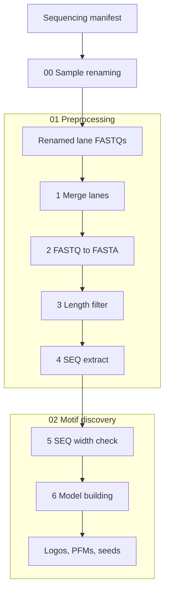

# Workflow

SELEX analysis steps that have scripts in this repository. Commands below are run from the repository root.

| Stage | Directory | Driver |
|-------|-----------|--------|
| Sample renaming | [00_sample_renaming](00_sample_renaming/README.md) | `selex_rename.py` |
| Preprocessing | [01_preprocessing](01_preprocessing/README.md) | `run_preprocess.sh` |
| Motif discovery | [02_motif_discovery](02_motif_discovery/README.md) | `run_motif.sh` |

Sample renaming is first. It turns Sanger run IDs into `HTS` or `NCAP` / TF+replicate / cycle folders. Preprocessing reads the FASTQs in those cycle folders.

A background library and a signal library are two preprocessing runs. Pass the SEQ files to `run_motif.sh` as `--background` and `--signal`.

Each numbered folder under a stage describes one process: what it does, its inputs, its outputs, and which command runs. The scripts stay in the stage directory. Preprocessing opens `config/adapters.fa` from two levels above the script, and each driver calls the other files in its own directory. A process folder is one level deeper, so the scripts were left beside the driver.

Enrichment filtering beyond the length window, library reformatting, motif-position matching, and mutual-information analysis have no scripts in this repository.

Shared pieces live outside this directory:

| Path | Role |
|------|------|
| [config](../config/README.md) | Adapter FASTA and the ligand length table |
| [data/examples](../data/examples/README.md) | Synthetic FASTA for the length filter and the SEQ extract |
| [envs](../envs/README.md) | Conda and pip installs |
| [tests](../tests/README.md) | Unit tests |
